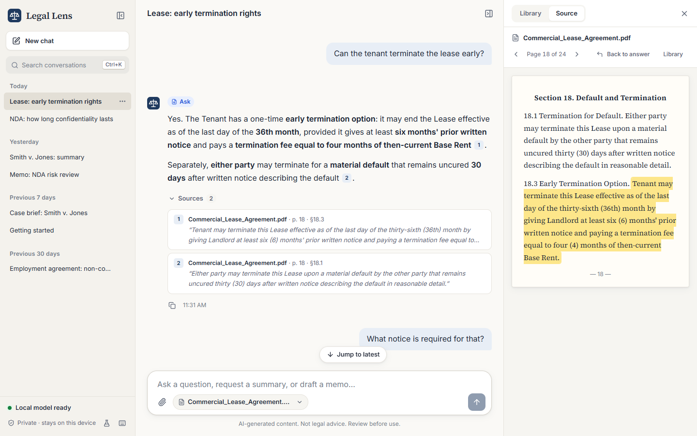

# Legal Lens — Frontend

The user interface for **Legal Lens**, a private, local AI assistant for lawyers. It answers questions from your documents (with citations), summarizes them, and drafts memos and case briefs.

It runs in two modes:
- **Mock mode** (the default, `npm run dev`): a **mock backend (MSW)** in the browser answers the real API endpoints. No Python needed, and every screen and state can be demoed.
- **Backend mode** (`npm run dev:stack`): the same UI talks to the real FastAPI service in [../backend](../backend). See [Running against the real backend](#running-against-the-real-backend).



## Quick start

```bash
npm install
npm run dev          # http://localhost:5173
```

Requires Node.js 20+ (developed on Node 24 LTS).

| Script | What it does |
|---|---|
| `npm run dev` | Dev server with hot reload and the mock backend |
| `npm run dev:stack` | Starts the FastAPI backend **and** the dev server in backend mode, in one terminal (needs [uv](https://docs.astral.sh/uv/)) |
| `npm run dev:api` | Dev server in backend mode only (start the backend yourself) |
| `npm run build` | Typecheck, then production build in `dist/` (mock mode) |
| `npm run build:api` | Typecheck, then production build in `dist-backend/` (backend mode, no mock code) |
| `npm run preview` · `preview:api` | Serve those builds at http://localhost:4173 · :4174 |
| `npm run lint` | ESLint, zero warnings allowed |
| `npm run typecheck` | TypeScript for the app, the tests and the tooling configs |
| `npm test` | Unit and component tests (Vitest + Testing Library + MSW) |
| `npm run test:e2e` | End-to-end demo path in Microsoft Edge (Playwright), against the mocks |
| `npm run test:e2e:api` | The same kind of demo path against the **real backend** (starts its own on port 8010 with a fresh data folder) |

## Demo script (BRD §7), mock mode

For the real backend, use the demo script in the [project README](../README.md#class-demo-script) instead.

The app opens with sample data: a commercial lease, a mutual NDA, a **scanned** court opinion, a document still being OCR'd and a failed upload.

1. **Ask:** *"Can the tenant terminate the lease early?"*, then click a citation chip. The Source tab opens the page with the quote highlighted.
2. **Follow-up:** *"What notice is required for that?"* The status line shows the query being rewritten with conversation context.
3. **Not found:** *"Does the lease include a non-compete clause?"* The app says so instead of guessing.
4. **Summary:** *"Summarize this lease"* returns six fixed sections, each cited.
5. **Draft:** *"Draft a memo on my exit options"* returns a serif memo with amber `[CONFIRM: …]` and `[CITATION NEEDED]` placeholders.
6. **Upload:** drag a PDF anywhere onto the window and watch the pipeline progress. Name it `*scan*.pdf` to see OCR, or `*corrupt*.pdf` to see a failure and Retry.
7. **Demo controls** (flask icon, bottom-left) simulate a slow model, a failed answer or an offline model runtime, and can **reset demo data**.

## Architecture

```
src/
  api/          typed API contract (types.ts), fetch client, SSE stream parser
  app/          providers, routes, three-column shell, error boundary
  components/   design-system primitives (Button, Dialog, Menu, Tooltip, Badge…)
  features/
    sidebar/    conversations grouped by date, search, rename, delete, model status
    chat/       thread, streaming, Ask / Summary / Draft / Clarify renderers, citations
    composer/   auto-growing input, document picker, stop/send
    documents/  library, upload, ingestion progress, global drop overlay
    source/     source viewer with highlighted excerpt and OCR confidence
    system/     model banner, shortcuts, demo controls, 404
  hooks/        TanStack Query hooks (queries.ts), auto-scroll
  store/        Zustand: UI state (persisted) and in-flight streams
  mocks/        MSW handlers + mock "AI layer" (intent, retrieval, ingestion)
  styles/       design tokens and global CSS
```

- **Styling:** plain CSS with design tokens (`styles/tokens.css`) and CSS Modules. The theme is light only.
- **Accessibility:** Radix primitives (focus management, keyboard support), visible focus rings, `aria-live` announcements when a reply finishes, and reduced-motion support.
- **Fonts:** Inter and Source Serif 4 are bundled locally, so the app works offline.

## Running against the real backend

The UI only ever calls relative `/api/*` URLs, so switching backends needs no UI code changes. Backend mode is the Vite mode file [.env.backend](.env.backend):
- `VITE_USE_MOCKS=false`: MSW never starts, and the mock code isn't even in the build.
- The dev and preview servers proxy `/api` to `VITE_API_TARGET` (default `http://127.0.0.1:8000`).

```bash
npm run dev:stack            # backend + frontend, Ctrl+C stops both
# load the demo data (in another terminal, from ../backend):
uv run python scripts/seed_demo.py
```

To point at a backend on another port or host, override the target: `VITE_API_TARGET=http://127.0.0.1:8010 npm run dev:api`, or put it in a git-ignored `.env.backend.local`.

Differences from mock mode:
- **Demo controls** (the flask icon) only exist in mock mode. With the real backend, the same scenarios are backend settings: `LL_STANDIN_TOKEN_DELAY_MS` (slow model), `LL_STANDIN_FAIL_MIDSTREAM`, `LL_STANDIN_MODEL_OFFLINE`. **Reset demo data** is `seed_demo.py --fresh`.
- **No OCR yet:** the backend's stand-in can't read scanned PDFs, so they show *Failed* until the AI layer arrives.
- **If the backend isn't running**, the app says *"Can't reach the Legal Lens service"* and reconnects by itself when it starts.

### API contract the backend must implement

These match `architecture/legal_lens_flow.excalidraw`, plus a few small additions marked ★.

| Endpoint | Purpose |
|---|---|
| `GET /api/conversations` · `POST` · `GET/PATCH/DELETE /api/conversations/{id}` | Sidebar and conversation history |
| `POST /api/chat/stream` | SSE events: `intent`★ (+ message ids), `status`★, `token`, `citation`, `done`★ (+ `outcome`, `suggestions`, `title`), `error` |
| `GET /api/documents` · `POST` (multipart) · `GET/DELETE /api/documents/{id}` | Library, upload and ingestion status |
| `POST /api/documents/{id}/retry` ★ | Re-run ingestion for a failed document |
| `GET /api/documents/{id}/pages/{n}` | Page text plus OCR flag and confidence, for the Source Viewer |
| `GET /api/health` | Model runtime status (`ready` / `loading` / `unavailable`) |

Errors use the envelope `{ code, message, request_id }`. All shapes are defined in [`src/api/types.ts`](src/api/types.ts).

## Testing

- **Unit:** SSE parsing (including split chunks), markdown citation and placeholder handling, date grouping, file validation, intent detection and the ingestion simulator. A check also confirms every mock citation quote really appears on its page.
- **Component:** the full app rendered against MSW: streaming answers with citations, the source viewer, not-found, clarify chips, offline model, sidebar search/rename/delete, upload and validation.
- **End-to-end:** `e2e/demo.spec.ts` runs the BRD demo path in Edge against the mocks, including Stop generating, reload and document deletion. `e2e/integration.spec.ts` (`npm run test:e2e:api`) runs it against the real backend with documents built by the backend's own factories. Set `PW_CHANNEL=chromium` to use Playwright's Chromium instead of Edge (CI does).
